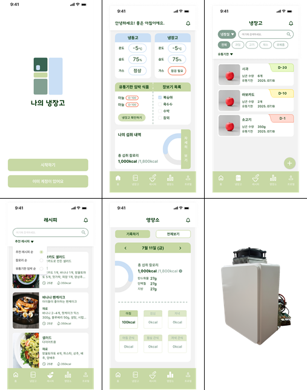
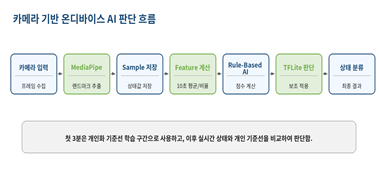
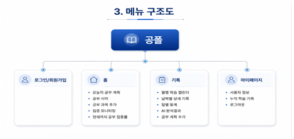
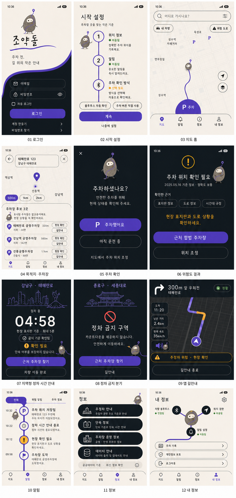
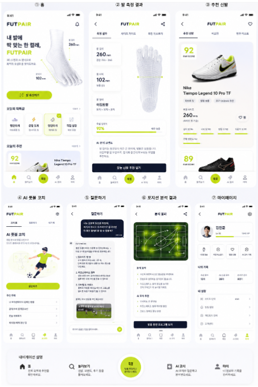

# Kim Ki-hwan

Service Planner · Product-minded Engineer

사용자 문제를 서비스 구조·사용자 흐름·정책으로 구체화하고, 생성형 AI를 활용해 빠르게 구현·검증하는 서비스기획자입니다.

## How I Work

Problem → User Flow → Requirements → Policy → Prototype → QA → Iteration

- Clean Architecture 관점에서 domain·application/data·presentation 책임을 분리
- Oracle_이음에서 GitFlow, feature branch, PR, staging·QA 흐름 적용
- Fitfoot에서 FastAPI·OpenAPI 계약으로 모바일·서버 요구사항 경계 관리
- AI는 구현 가속에 활용하고, 저는 요구사항·우선순위·예외조건·Acceptance Criteria와 검증 결과를 책임

## Featured Projects

### [지능형 냉장고](https://github.com/kihwan04/smartfridge-nutrition-manager) · SmartFridge Nutrition Manager

냉장고 상태와 식재료의 유통기한을 확인하고, 레시피 탐색부터 식사와 영양소 기록까지 이어지는 Flutter 앱 프로토타입입니다.

- **주요 기능** — 냉장고 온도·습도·가스 상태 확인, 식재료 수량과 유통기한 관리, 장보기 목록, 칼로리·탄수화물·단백질·지방 섭취량 기록
- **담당** — 영양성분 조회·계산·기록·시각화 요구사항을 정의하고 API 결과를 검증했습니다.
- **시스템 설계** — Raspberry Pi에서 센서 데이터를 수집하고, Firebase 인증·데이터베이스를 통해 Flutter 앱과 연동하는 구조입니다.
- **검증** — 영양성분 API 응답과 칼로리·탄수화물·단백질·지방 집계 결과를 확인했습니다. 공개 저장소의 영양 기록 데모는 샘플 데이터를 사용합니다.

시스템 구성도

### [공폴](https://github.com/csg5101/gongpol) · Gongpol

공부 시간을 기록하고 카메라 기반 온디바이스 AI로 학습 중 집중 상태를 분석하는 Flutter 팀 프로젝트입니다. 공부를 마치면 세션 시간과 집중도 분석, 피드백을 확인하고 달력에서 이전 학습 기록을 볼 수 있습니다.

- **담당** — 집중도 판정 정책, 사용자별 기준선 요구사항, 예외조건, 결과 리포트와 QA 기준을 정의했습니다.
- **집중 상태 판정** — MediaPipe로 카메라 프레임에서 랜드마크를 추출하고, 첫 3분의 샘플로 사용자별 기준선을 만듭니다. 이후 10초 단위로 집계한 특징을 개인 기준선과 비교해 규칙 기반 점수를 계산하고, TensorFlow Lite 판정을 보조로 적용합니다.
- **앱 구성** — Flutter, Supabase, Clean Architecture 계층 구조
- **검증** — 실제 모바일 기능을 검증하고 카메라 기반 AI 집중도 분석 논문을 작성했습니다.

온디바이스 AI 판정 흐름과 메뉴 구조

### [컴콩닥](https://github.com/kihwan04/Festival52) · 축제 QR 주문·운영 시스템
축제 부스에서 테이블·포장 QR 주문을 받고 입금 확인부터 조리, 전달까지 관리한 웹앱입니다.

- **담당** — 제품 흐름, 요구사항, 도메인 정책, 운영 예외조건과 QA 기준을 정의했습니다.
- **현장 운영** — 축제 3일 동안 QR 주문을 처리하며 당일 매출과 메뉴별 판매 수량을 바로 확인했습니다. 10월 1일 대시보드에는 매출 769,200원, 입금 확인 97건, 판매 147개가 기록됐습니다.
- **정산 결과** — 3일 운영 후 부스 자리 비용을 포함한 운영비를 정산해 **30만 원의 이익**을 남겼습니다.
- **고객 대기 경험** — 음식이 준비되는 동안 손님이 즐길 수 있도록 주문 현황에 랜덤 타이밍 미니게임을 넣었습니다. 주문당 3회 도전할 수 있고, 성공하면 무료 안주 1개를 받을 수 있습니다.
- **기술** — Next.js/Vinext, React, TypeScript, Supabase, PostgreSQL, Zod, Web Push
- **개발 검증** — 도메인 테스트 53개, HTML 렌더링 테스트 및 프로덕션 빌드 통과

[현장 운영 결과와 고객·운영자 화면 전체 보기](https://github.com/kihwan04/Festival52#축제-현장-운영-결과)

### [Oracle_이음](https://github.com/kihwan04/Oracle_ieum) · Flagship Team Project
Oracle Cloud 주차 위험도 데이터를 모바일 앱과 Kakao 지도·길안내로 연결한 팀 프로젝트입니다.

- My role: 서비스 구조, GitFlow·feature branch·PR 흐름, 위험도 판정 요구사항, API·지도·QA 우선순위
- Tech: FastAPI, Oracle Autonomous Database/Spatial, Expo React Native, Kakao Maps, OCI, EAS
- Evidence: 현재 데이터 기준 위험 상황 판정 완료 · API pytest 46개 · 모바일 Jest 61개

#### 조약돌 앱 화면 설계와 시연

화면 설계에는 시작 설정, 지도에서 주차장 찾기, 주차 확인, 위험도 안내, 길안내와 알림까지 12개 화면을 담았습니다.

[조약돌 앱 시연 하이라이트 (MP4)](assets/portfolio/oracle-ieum/joyakdol-app-demo.mp4)에서 시작 설정, 목적지 주변 주차장 후보, 주차 확인, 정차 위험 안내를 볼 수 있습니다.

### Fitfoot · 개발 중

발 길이·발볼 측정값과 착화 선호를 바탕으로 풋살화를 추천하고, AI 풋볼 코치를 제공하는 모바일 MVP를 개발 중입니다.

- **담당** — 사용자 흐름, 촬영 가능 여부와 실패 시 대체 흐름, AI 코치 요구사항, API 계약과 QA 기준을 정의하고 있습니다.
- **화면 설계** — 홈, 발 측정 결과, 추천 신발, AI 풋볼 코치, 질문하기, 포지션 분석 결과, 마이페이지를 설계했습니다.
- **기술** — Expo React Native, TypeScript, FastAPI, PostgreSQL, Supabase, OpenAPI, RLS

### [몽스케이프](https://github.com/kihwan04/Mongscape) · Mongscape

키보드나 웹캠 몸동작으로 플레이하는 Unity 기반 Windows 3레인 운동 러너입니다. 광산과 감옥을 달리며 장애물을 피하고, 코인을 모으며 경찰의 추격에서 벗어납니다. 운동 모드에서는 몸동작을 바탕으로 추정한 소모 칼로리를 화면에 표시합니다.

[플레이 화면과 프로젝트 안내](https://github.com/kihwan04/Mongscape/blob/f7e918186f13ad4ca6662ac02f2693d741310fdb/README.md#플레이-화면)

## AI-assisted Development Workflow

1. 문제·사용자 상황 정의
2. User Flow·요구사항·정책·Acceptance Criteria 작성
3. Codex에 구현 범위와 제약 전달
4. 결과를 요구사항과 비교하고 누락·오류 수정 지시
5. 테스트·실기기·데이터 결과 확인 후 iteration

## Portfolio Notice

© 2026 Kim Ki-hwan. 이 README의 아이디어·문서·표현은 취업 검토 목적의 열람을 위한 것입니다. 별도 라이선스가 없는 파일의 재사용·재배포·상업적 이용·2차 제작은 사전 허가 없이 허용하지 않습니다.
