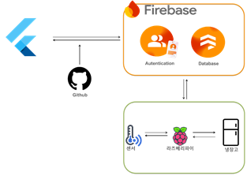
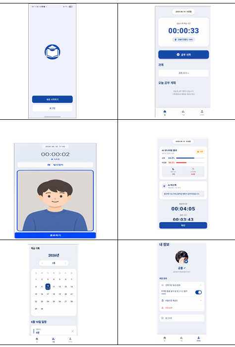

# Kim Ki-hwan

Service Planner · Product-minded Engineer

사용자 문제를 서비스 구조·사용자 흐름·정책으로 구체화하고, 생성형 AI를 활용해 빠르게 구현·검증하는 서비스기획자입니다.

## How I Work

Problem → User Flow → Requirements → Policy → Prototype → QA → Iteration

- Clean Architecture 관점에서 domain·application/data·presentation 책임을 분리
- Oracle_이음에서 GitFlow, feature branch, PR, staging·QA 흐름 적용
- FUTPAIR에서 FastAPI·OpenAPI 계약으로 모바일·서버 요구사항 경계 관리
- AI는 구현 가속에 활용하고, 저는 요구사항·우선순위·예외조건·Acceptance Criteria와 검증 결과를 책임

## Featured Projects

### [지능형 냉장고](https://github.com/kihwan04/smartfridge-nutrition-manager) · SmartFridge Nutrition Manager

냉장고 상태와 식재료의 유통기한을 확인하고, 레시피 탐색부터 식사와 영양소 기록까지 이어지는 Flutter 앱 프로토타입입니다.

- **주요 기능** — 냉장고 온도·습도·가스 상태 확인, 식재료 수량과 유통기한 관리, 장보기 목록, 칼로리·탄수화물·단백질·지방 섭취량 기록
- **담당** — 영양성분 조회·계산·기록·시각화 요구사항을 정의하고 API 결과를 검증했습니다.
- **시스템 설계** — Raspberry Pi에서 센서 데이터를 수집하고, Firebase 인증·데이터베이스를 통해 Flutter 앱과 연동하는 구조입니다.
- **검증** — 영양성분 API 응답과 칼로리·탄수화물·단백질·지방 집계 결과를 확인했습니다. 공개 저장소의 영양 기록 데모는 샘플 데이터를 사용합니다.

시스템 구성도

### [공폴](https://github.com/csg5101/gongpol) · Gongpol

공부 시간을 기록하고 카메라 기반 온디바이스 AI로 학습 중 집중 상태를 분석하는 Flutter 팀 프로젝트입니다. 공부를 마치면 세션 시간과 집중도 분석, 피드백을 확인하고 달력에서 이전 학습 기록을 볼 수 있습니다.

- **담당** — 집중도 판정 정책, 사용자별 기준선 요구사항, 예외조건, 결과 리포트와 QA 기준을 정의했습니다.
- **집중 상태 판정** — MediaPipe로 카메라 프레임에서 랜드마크를 추출하고, 첫 3분의 샘플로 사용자별 기준선을 만듭니다. 이후 10초 단위로 집계한 특징을 개인 기준선과 비교해 규칙 기반 점수를 계산하고, TensorFlow Lite 판정을 보조로 적용합니다.
- **앱 구성** — Flutter, Supabase, Clean Architecture 계층 구조
- **검증** — 실제 모바일 기능을 검증하고 카메라 기반 AI 집중도 분석 논문을 작성했습니다.

온디바이스 AI 판정 흐름과 메뉴 구조

### [Festival52](https://github.com/kihwan04/Festival52) · Current Project / Field Use
축제 현장에서 직접 활용할 테이블 QR 주문·포장 주문·결제 확인·조리·전달·재고·매출 운영 웹앱입니다.

- My role: 제품 흐름, 요구사항, 도메인 정책, 운영 예외조건, QA 기준 정의
- Tech: Next.js/Vinext, React, TypeScript, Supabase, PostgreSQL, Zod, Web Push
- Evidence: 53 domain tests, rendered HTML tests, production build 통과 · 실제 축제 활용 예정

### [Oracle_이음](https://github.com/kihwan04/Oracle_ieum) · Flagship Team Project
Oracle Cloud 주차 위험도 데이터를 모바일 앱과 Kakao 지도·길안내로 연결한 팀 프로젝트입니다.

- My role: 서비스 구조, GitFlow·feature branch·PR 흐름, 위험도 판정 요구사항, API·지도·QA 우선순위
- Tech: FastAPI, Oracle Autonomous Database/Spatial, Expo React Native, Kakao Maps, OCI, EAS
- Evidence: 현재 데이터 기준 위험 상황 판정 완료 · API pytest 46개 · 모바일 Jest 61개

### FUTPAIR / SoccerMarketProject · In Progress MVP
발 측정값과 착화 선호를 바탕으로 풋살화 추천과 AI Coach를 제공하는 진행 중 MVP입니다.

- My role: 사용자 흐름, 촬영 readiness·fallback 정책, AI Coach 요구사항, API 계약과 QA 기준
- Tech: Expo React Native, TypeScript, FastAPI, PostgreSQL, Supabase, OpenAPI, RLS

## AI-assisted Development Workflow

1. 문제·사용자 상황 정의
2. User Flow·요구사항·정책·Acceptance Criteria 작성
3. Codex에 구현 범위와 제약 전달
4. 결과를 요구사항과 비교하고 누락·오류 수정 지시
5. 테스트·실기기·데이터 결과 확인 후 iteration

## Portfolio Notice

© 2026 Kim Ki-hwan. 이 README의 아이디어·문서·표현은 취업 검토 목적의 열람을 위한 것입니다. 별도 라이선스가 없는 파일의 재사용·재배포·상업적 이용·2차 제작은 사전 허가 없이 허용하지 않습니다.
